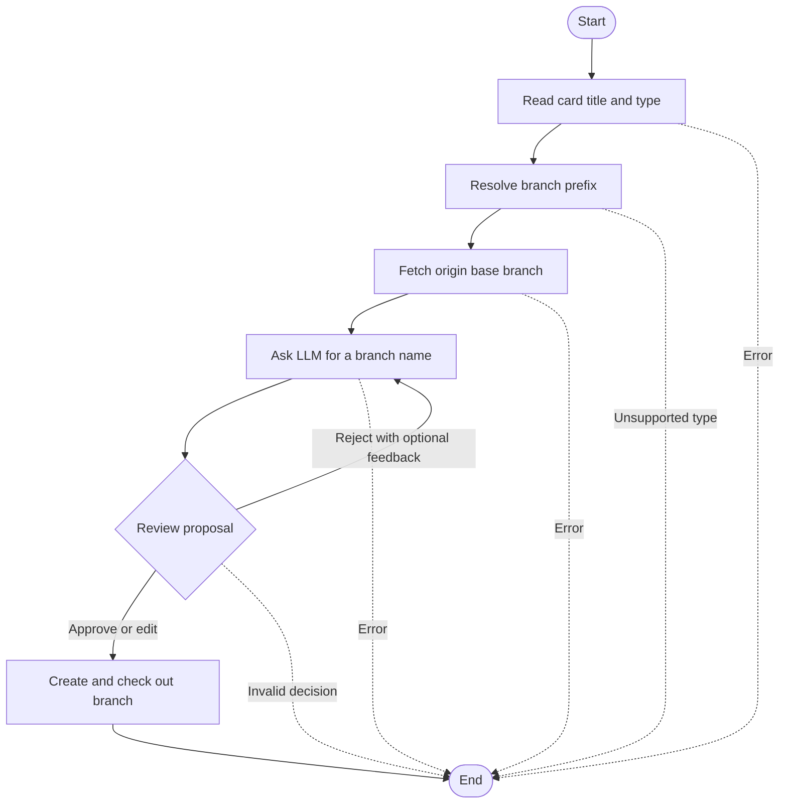
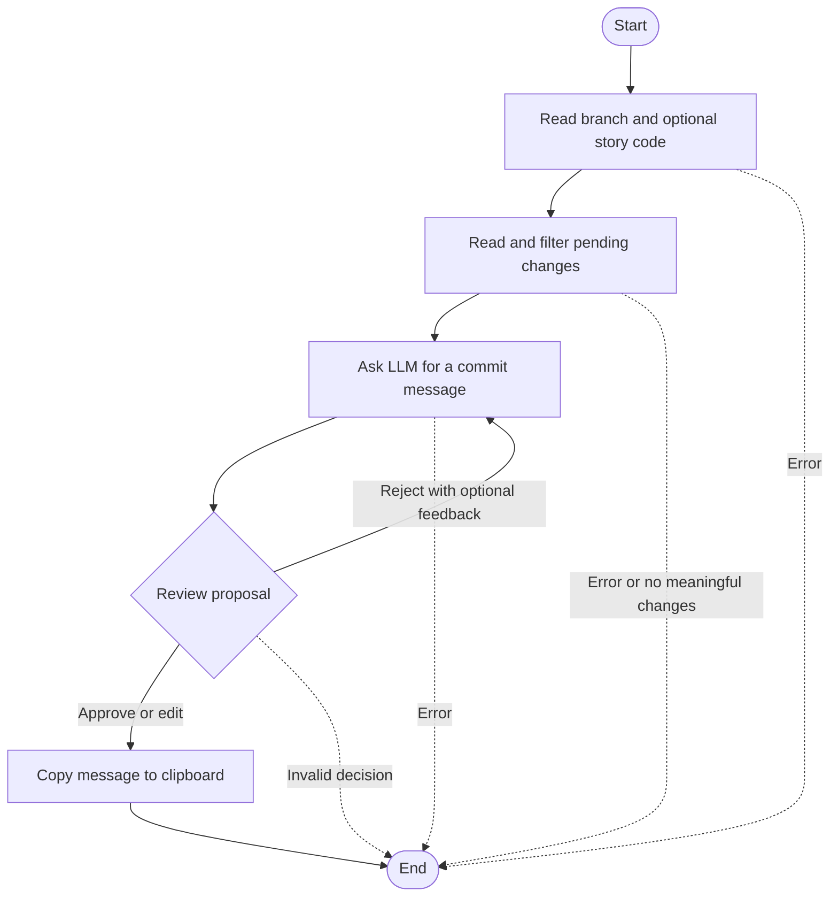

# DevFlow

[Back to AI tools](../README.md)

Personal development-workflow automation tools, built as [LangGraph](https://langchain-ai.github.io/langgraph/) graphs.

| Command | Input | Result |
| --- | --- | --- |
| `start-branch` | Azure DevOps work item or GitHub issue ID. | Creates and checks out a branch after you approve or edit its name. |
| `commit-message` | Pending changes in the current Git repository. | Copies an approved or edited commit message to the Windows clipboard. |

Both commands call [AgentGateway](../AgentGateway.Api/README.md) for LLM proposals. The [Azure DevOps MCP](../MCPs/AzureDevOps/README.md) is a separate integration and is not required to run these flows.

## start-branch

Creates a ready-to-use git branch from a card id, in the repository of the current directory. The card is read from Azure DevOps (default) or from GitHub.

1. Reads the card title and type. Azure DevOps: `Bug`, `Freshdesk Bug`, and `Service Request` → `bugfix/`; `User Story`, `Product Backlog Item`, and `Issue` → `feature/`. GitHub issues: label `bug` → `bugfix/`, any other issue → `feature/`. Any other type ends with an error.
2. Runs `git fetch origin <BASE_BRANCH>`.
3. Asks the LLM for a short English slug and proposes `{prefix}{id}-{slug}`.
4. Asks you to confirm: approve, edit the name, or reject with feedback (it generates a new proposal).
5. Creates the branch with `git checkout -b <name> origin/<BASE_BRANCH>` and shows the LLM usage.



The review pauses the graph with a LangGraph interrupt. Rejecting generates another proposal; editing uses your supplied name directly. Branch creation success or failure ends the graph, and the CLI reports the result and accumulated LLM usage.

### Requirements

- [uv](https://docs.astral.sh/uv/) (installs Python 3.12 and the dependencies).
- Git available on PATH.
- [AgentGateway](../AgentGateway.Api/README.md) running (`POST /api/prompts`, default `http://localhost:5052/api/prompts`).
- For Azure DevOps: a PAT with read permission on work items.
- For GitHub: a token with read access to the issues of the repository.

### Installation

```bash
cd DevFlow
uv sync
```

Run this from the repository root; the remaining local commands in this guide assume the `DevFlow` directory unless stated otherwise.

### Configuration

Copy `.env.example` to `.env` and fill it in. The `.env` file is not versioned.

| Variable | Required | Default |
|---|---|---|
| `DEFAULT_TRACKER` | no | `ado` (also accepts `github`) |
| `ADO_ORGANIZATION` | with `ado` | |
| `ADO_PROJECT` | with `ado` | |
| `ADO_PAT` | with `ado` | |
| `GITHUB_TOKEN` | with `github` | |
| `LLM_API_URL` | no | `http://localhost:5052/api/prompts` |
| `LLM_API_KEY` | yes | |
| `BASE_BRANCH` | no | `develop` |

Only the variables of the tracker in use are required.

`LLM_API_KEY` must match AgentGateway's `Authentication__ApiKey`. Set `BASE_BRANCH=main` when working on AI tools, whose principal branch is `main`; keep `develop` only for repositories that use it. DevFlow reads a raw `ADO_PAT` from its own configuration and does not load the MCP integration's DPAPI file.

### Usage

From the DevFlow folder:

```bash
uv run start-branch 12345
```

The branch is created in the repository of the current directory. To use it on another repository, run it from there and point to the project:

```bash
uv run --project <path-to-DevFlow> start-branch 12345
```

Choose the tracker with `-t` or `--tracker` (`ado` or `github`). Without it, `DEFAULT_TRACKER` is used, or `ado` if it is not set:

```bash
start-branch 42 --tracker github
start-branch 42 -t github
```

With GitHub, the owner and repository are deduced from the `origin` remote of the current directory, so it must point to `github.com`. The number is read as an issue of that repository (pull requests are rejected). The Project board itself is not read.

## commit-message

Proposes a commit message from the pending git changes of the current directory and copies it to the clipboard. It is the graph version of the `git-commit-message` skill. It does not run `git commit`.

1. Reads the current branch and takes the story code (5 digits after the branch prefix, for example `feature/52691-name`). Without a code, the suffix is left out.
2. Reads the pending changes (staged, unstaged and untracked). It ignores hidden files, generated outputs (`bin/`, `obj/`, ...), `git-changes-summary*` and lock files (lock files are used only when they are the only change).
3. Asks the LLM for the commit type and a one-line English description, then builds `<type>: <Description>. story: #<code>`.
4. Asks you to confirm: approve, edit the message, or reject with feedback (it generates a new proposal).
5. Copies the message to the clipboard (Windows, with `clip`) and shows the LLM usage.



The review uses the same interrupt and resume mechanism as `start-branch`. Rejecting generates another message; editing copies your replacement directly. Clipboard success or failure ends the graph. No commit or push is performed by this command.

The description targets 50-70 characters. Change it with `-l` or `--length`:

```bash
uv run commit-message
uv run commit-message --length 80-100
```

It only needs `LLM_API_KEY` and `LLM_API_URL` (optional). The tracker variables are not required.

## Install as a global command

To run `start-branch` and `commit-message` from any folder, without `uv run`, install DevFlow as a `uv` tool. These steps also work to set it up on a new computer (Windows, PowerShell).

1. Install [uv](https://docs.astral.sh/uv/):

   ```powershell
   winget install --id=astral-sh.uv -e
   ```

2. Clone the repository:

   ```powershell
   git clone https://github.com/juampiii/ai-tools.git C:\Repos\ai-tools
   cd C:\Repos\ai-tools\DevFlow
   ```

3. Create the `.env` file from the example and fill it in (see [Configuration](#configuration)):

   ```powershell
   Copy-Item .env.example .env
   ```

4. Install the commands:

   ```powershell
   uv tool install --editable .
   ```

5. Open a new terminal and check them:

   ```powershell
   start-branch --help
   commit-message --help
   ```

Notes:

- The installation is editable: changes in the code apply without reinstalling. Run `uv tool install --editable . --force` again only when a command is added or renamed in `pyproject.toml`.
- If the commands are not found, run `uv tool update-shell` and open a new terminal.
- The commands always read the `.env` file of the DevFlow folder, whatever the current folder is. Variables already defined in the environment take priority over it.
- The local LLM API must be reachable from the new computer. If it runs elsewhere, point `LLM_API_URL` to it.
- `commit-message` copies with `clip.exe`, so it works only on Windows.

## Development

```bash
uv run pytest
uv run ruff check --fix
uv run ruff format
```
