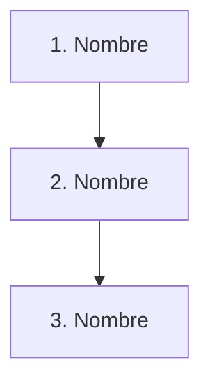

# [Identificador] · [Título de la historia]

**Issue:** [Enlace o referencia]
**Fecha del plan:** [AAAA-MM-DD]
**Estado del plan:** [Propuesto / Acordado]
**Estado de la historia:** [Sin comenzar / En curso / Finalizada / Resultado parcial]
**Última revisión:** [AAAA-MM-DD]
**Origen:** [Plan previo al trabajo / Reconstrucción retrospectiva y fuentes utilizadas]

<!-- Sustituir las indicaciones entre corchetes. Conservar pendiente el cierre hasta
terminar. Eliminar estos comentarios del documento generado. -->

## 1. Objetivo

[Primer párrafo: problema que queremos resolver y resultado que buscamos.]

[Segundo párrafo: cómo se utilizará el resultado, alcance y exclusiones relevantes.]

## 2. Contexto

<!-- Opcional: incluir únicamente el punto de partida y las restricciones relevantes. -->

[Qué existe, qué falta y qué condiciona la solución.]

## 3. Decisiones de partida

| Decisión | Motivo | Alternativa considerada |
| --- | --- | --- |
| [Elección relevante] | [Por qué encaja] | [Otra opción y motivo para descartarla] |

### Dudas pendientes

<!-- Omitir si no hay dudas. No presentar suposiciones como decisiones confirmadas. -->

| Duda | Cómo se resolverá | Paso que depende de ella |
| --- | --- | --- |
| [Pregunta] | [Consulta o comprobación] | [Identificador] |

## 4. Vista general de los pasos

<!-- Nombrar cada paso con una acción y un objeto o capacidad concretos; añadir el
destino cuando ayude. Ejemplo: «Construir y publicar las imágenes Docker en GHCR»,
en lugar de «Preparar pruebas y publicación». El título identifica el resultado
principal; las pruebas previas y otras tareas de apoyo se explican en su ficha.
El resultado esperado describe un estado comprobable, no repite el título.
No inventar herramientas o destinos que todavía no se hayan acordado. -->

| Paso | Qué haremos | Resultado esperado |
| --- | --- | --- |
| 1 · [Nombre] | [Trabajo previsto] | [Resultado observable] |
| 2 · [Nombre] | [Trabajo previsto] | [Resultado observable] |
| 3 · [Nombre] | [Trabajo previsto] | [Resultado observable] |

<!-- Adaptar este diagrama a las dependencias reales y utilizar los mismos nombres
de la tabla y de las fichas. Para ramas paralelas, ver el ejemplo de la skill. -->

## 5. Descripción de los pasos

<!-- Repetir la ficha para cada paso de la tabla con el mismo nombre concreto.
El criterio de aceptación debe demostrar el resultado esperado de ese paso. -->

### Paso 1 · [Nombre]

**Qué queremos conseguir**

[Subobjetivo y relación con el objetivo general.]

**Qué haremos**

- [Tarea o subtarea concreta.]

**Qué necesitas entender**

[Conceptos técnicos que intervienen, para qué los usamos y un ejemplo si ayuda.
Omitir si no hay conceptos que necesiten explicación.]

**Cómo comprobaremos que está terminado**

- [Criterio de aceptación observable.]

**Si algo falla**

[Opcional: primera comprobación, dependencia que revisar o condición para reintentar.]

**Resultado que deja este paso**

[Archivo, configuración, servicio o evidencia prevista y dónde se localizará.]

## 6. Cierre de la historia

Pendiente de completar al terminar. El plan original se conserva en los apartados anteriores.

### Resultado final

[Qué conseguimos y cómo se utiliza. Fecha de cierre o de revisión del resultado parcial.]

### Cambios respecto al plan original

| Paso | Lo previsto | Lo realizado | Motivo |
| --- | --- | --- | --- |
| [Identificador] | [Plan inicial] | [Resultado real] | [Qué motivó el cambio] |

<!-- Si no hubo desviaciones, indicarlo y eliminar la tabla vacía. -->

### Validación realizada

- [Comprobación, resultado y enlace a evidencia. Indicar qué no se ha verificado.]

### Pendientes y limitaciones

- [Trabajo pendiente, limitación conocida o futura issue; o indicar que no hay pendientes.]

## 7. Referencia técnica final

<!-- Completar al cierre: archivos, variables y secretos (sin valores sensibles),
servicios, endpoints, logs y enlaces a guías vigentes. Evitar duplicar esas guías. -->

[Dónde encontrar lo necesario para entender y mantener lo realizado.]

## 8. Palabras clave

[Etiquetas útiles para encontrar la historia.]
