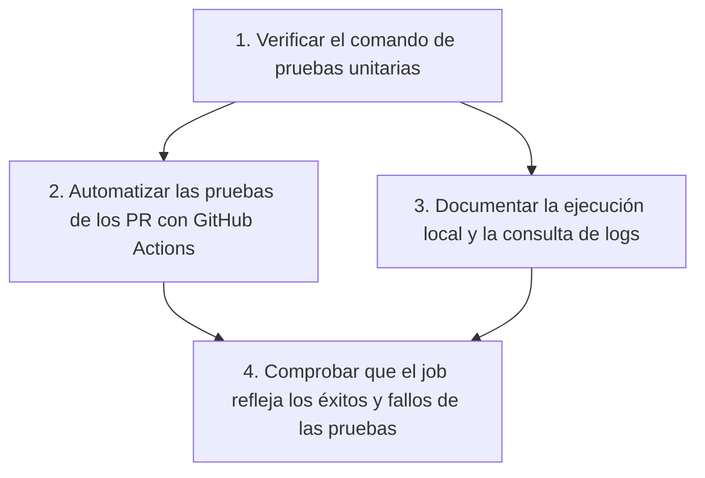

# DEMO · Automatizar las pruebas de un repositorio

> Ejemplo ficticio del formato completado. Las rutas, decisiones y resultados
> ilustran el procedimiento; no describen comprobaciones de HappyMeal.

**Issue:** DEMO, sin issue externa
**Fecha del plan:** 2026-01-10
**Estado del plan:** Acordado
**Estado de la historia:** Finalizada
**Última revisión:** 2026-01-12
**Origen:** Ejemplo ficticio de plan previo al trabajo

## 1. Objetivo

Actualmente las pruebas solo se ejecutan cuando alguien recuerda lanzarlas en su
ordenador. Queremos que cada PR muestre si la propuesta supera las pruebas unitarias.

Al abrir o actualizar un PR, GitHub ejecutará las pruebas y mostrará su resultado.
Esta historia incluye la ejecución y su documentación; la protección de ramas se
tratará por separado y no se automatizará ningún despliegue.

## 2. Contexto

El repositorio ya tiene pruebas unitarias que funcionan localmente. Todavía no hay
un workflow de integración continua. No se necesitan secretos para estas pruebas.

## 3. Decisiones de partida

| Decisión | Motivo | Alternativa considerada |
| --- | --- | --- |
| Utilizar GitHub Actions | El código y los PR ya están en GitHub | Otro servicio de CI añadiría configuración externa |

## 4. Vista general de los pasos

| Paso | Qué haremos | Resultado esperado |
| --- | --- | --- |
| 1 · Verificar el comando de pruebas unitarias | Ejecutar las pruebas existentes | Comando reproducible |
| 2 · Automatizar las pruebas de los PR con GitHub Actions | Configurar el evento de PR y las pruebas | Ejecución automática |
| 3 · Documentar la ejecución local y la consulta de logs | Documentar cómo interpretar el resultado | Guía breve para colaboradores |
| 4 · Comprobar que el job refleja los éxitos y fallos de las pruebas | Revisar el comportamiento en un PR | Éxito y fallo visibles |

Los pasos 2 y 3 pueden avanzar en paralelo tras confirmar el comando. Su comprobación
conjunta se hace en el paso 4.

## 5. Descripción de los pasos

### Paso 1 · Verificar el comando de pruebas unitarias

**Qué queremos conseguir:** conocer el comando que deberá ejecutar GitHub.

**Qué haremos:** ejecutar las pruebas unitarias existentes desde una copia del repositorio.

**Cómo comprobaremos que está terminado:** las pruebas terminan correctamente y el
comando identifica explícitamente el proyecto de pruebas unitarias.

**Resultado que deja este paso:** comando que se incorporará al workflow y a la guía.

### Paso 2 · Automatizar las pruebas de los PR con GitHub Actions

**Qué queremos conseguir:** ejecutar esas pruebas al abrir o actualizar un PR.

**Qué haremos:** crear `.github/workflows/tests.yml` con preparación del entorno y pruebas.

**Qué necesitas entender:** un workflow es un archivo YAML que define una automatización.
El evento `pull_request` la inicia al cambiar un PR; un job agrupa pasos que se ejecutan
en un runner, la máquina que proporciona el entorno de ejecución.

**Cómo comprobaremos que está terminado:** un PR inicia el job y sus logs muestran
el comando confirmado en el paso 1.

**Si algo falla:** si el comando funciona localmente, comparar primero el entorno
del runner y su directorio de trabajo antes de modificar las pruebas.

**Resultado que deja este paso:** `.github/workflows/tests.yml`.

### Paso 3 · Documentar la ejecución local y la consulta de logs

**Qué queremos conseguir:** que un colaborador sepa interpretar un resultado fallido.

**Qué haremos:** documentar el comando local y cómo encontrar el job y sus logs.

**Cómo comprobaremos que está terminado:** siguiendo la guía se localizan el resultado
del PR y el comando para reproducir las pruebas.

**Resultado que deja este paso:** `docs/testing.md`.

### Paso 4 · Comprobar que el job refleja los éxitos y fallos de las pruebas

**Qué queremos conseguir:** demostrar que el resultado representa el estado de las pruebas.

**Qué haremos:** observar una ejecución correcta y una con un fallo temporal controlado.
Retirar el fallo temporal antes de finalizar.

**Cómo comprobaremos que está terminado:** el job falla cuando falla una prueba,
pasa al corregirla y la guía coincide con lo observado.

**Resultado que deja este paso:** referencias a las ejecuciones de validación en el cierre.

## 6. Cierre de la historia

### Resultado final

En este ejemplo, el workflow quedó operativo el 2026-01-12: cada PR ejecuta las
pruebas y permite consultar el resultado desde sus comprobaciones.

### Cambios respecto al plan original

| Paso | Lo previsto | Lo realizado | Motivo |
| --- | --- | --- | --- |
| 3 | Crear `docs/testing.md` | Añadir la explicación a `CONTRIBUTING.md` | Se encontró una guía existente para colaboradores |

### Validación realizada

Se simularon un resultado correcto y otro con una prueba fallida; después se retiró
el fallo temporal. En una historia real se enlazarían aquí las ejecuciones observadas.
Este ejemplo no aporta evidencia de una ejecución real.

### Pendientes y limitaciones

Exigir estas pruebas para fusionar PR queda para otra issue, tal como se delimitó
en el objetivo inicial. No se incluyen pruebas de integración.

## 7. Referencia técnica final

- `.github/workflows/tests.yml`: evento de PR, preparación del entorno y comando de pruebas.
- `CONTRIBUTING.md`: ejecución local y consulta de logs desde las comprobaciones del PR.
- No se añadieron secretos ni variables propias del repositorio.

## 8. Palabras clave

`github-actions`, `pruebas-unitarias`, `integracion-continua`
